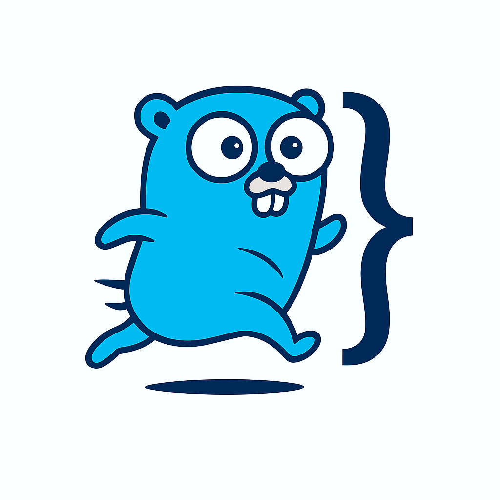

<p align="center">
  <a href="https://gofasta.dev"></a>
</p>

<h1 align="center">Gofasta</h1>

<p align="center"><strong>A production-shaped Go backend in one command.</strong></p>

Gofasta is two things that work together. A CLI that scaffolds a complete project and runs your dev loop, and a library of independent packages for the parts every backend needs and nobody wants to write again: auth, caching, database setup, email, queues, scheduling, observability and more. Use what you need, skip the rest. It's plain, idiomatic Go you can read, and replace if you outgrow it.

```bash
go install github.com/gofastadev/cli/cmd/gofasta@latest
gofasta new myapp && cd myapp
gofasta dev
```

That gives you a REST API with migrations, JWT auth, background jobs, Docker, CI workflows and a hot-reloading dev stack, with a `User` resource already wired in so it compiles and runs before you touch a line. Everything else, from guides to the per-package API reference, is at **[gofasta.dev](https://gofasta.dev)**.

## Where things live

| Repo | What it is | Go here for |
|------|-----------|-------------|
| [`gofasta`](https://github.com/gofastadev/gofasta) | The library. Every package under `pkg/*` your project imports. | Bugs or ideas about a package, API questions |
| [`cli`](https://github.com/gofastadev/cli) | The `gofasta` binary: `new`, `generate`, `dev`, `deploy`. | Scaffolding, generators, the dev loop, releases |
| [`website`](https://github.com/gofastadev/website) | [gofasta.dev](https://gofasta.dev): docs and blog. | Typos, unclear docs, missing guides |

Not sure which one? Open the issue where you hit the problem. We'll move it if it belongs elsewhere.

## Why people pick it

- **No lock-in.** Each library package stands on its own, and the CLI never imports the library at runtime. Delete what you don't use, fix the two or three files that imported it, and move on. We measure that count per package and publish it in the white paper.
- **Built for coding agents.** Every command takes `--json`, every error carries a stable code with a fix hint and a docs link, and `gofasta ai claude|cursor|codex|aider|windsurf` sets up your agent in one go.
- **Ready to ship.** Docker files, a one-command VPS deploy over SSH, systemd and nginx config, and GitHub Actions templates come out of `gofasta new`.
- **Honest about where it is.** We're pre-1.0 (`v0.1.x`). APIs can still move, which is also the best time to shape them.

## Help build it

Pull requests, bug reports and "this doc confused me" issues are all welcome. Each repo has a `CONTRIBUTING.md` with the local setup and the checks CI runs. If you want a place to start, pick a package you already know well and read its tests; gaps there are the easiest first contribution.

Using Gofasta somewhere? Star the [library](https://github.com/gofastadev/gofasta), and tell us what you built. It helps us decide what to work on next.

MIT licensed. Made by people who were tired of writing the same first two weeks of every backend.
